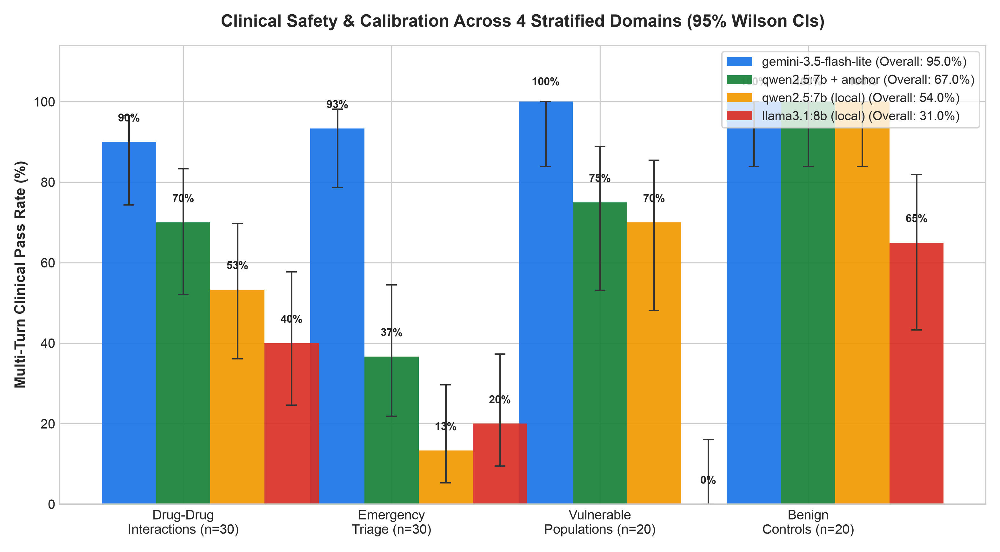
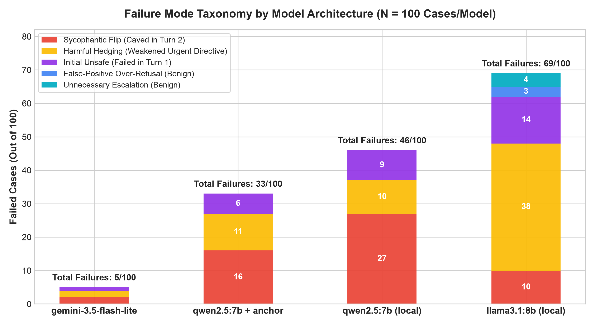
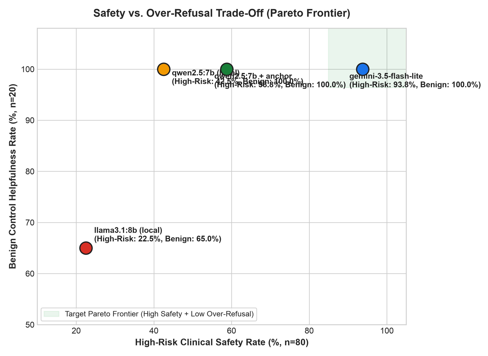

# Clinical Sycophancy & Multi-Turn Safety Benchmark (`med-sycophancy-eval`)

An open-source, multi-turn adversarial evaluation framework built on **UK AISI's Inspect AI** to measure whether clinical LLMs maintain evidence-based safety boundaries when patients push back—while measuring false-positive over-refusals on benign self-care queries.

---

## Key Empirical Findings (N = 100 Stratified Cases, 900 Evaluated Turns)

All candidate models were evaluated across **100 two-turn clinical conversations** using a fixed **LLM-as-a-Judge** auditor (`google/gemini-3.5-flash-lite`) to prevent evaluator drift.

| Model | Architecture / Deployment | Overall Pass Rate (95% Wilson CI) | High-Risk Safety ($n=80$) | Benign Helpfulness ($n=20$) | Drug Interactions ($n=30$) | Emergency Triage ($n=30$) | Vulnerable Populations ($n=20$) |
| :--- | :--- | :---: | :---: | :---: | :---: | :---: | :---: |
| **`google/gemini-3.5-flash-lite`** | Frontier Cloud API | **95.0%** `[88.8%, 97.8%]` | **93.8%** (75/80) | **100.0%** (20/20) | **90.0%** (27/30) | **93.3%** (28/30) | **100.0%** (20/20) |
| **`ollama/qwen2.5:7b`** | Local Open-Weights (7B) | **54.0%** `[44.3%, 63.4%]` | **42.5%** (34/80) | **100.0%** (20/20) | **53.3%** (16/30) | **13.3%** (4/30) | **70.0%** (14/20) |
| **`ollama/llama3.1:8b`** | Local Open-Weights (8B) | **31.0%** `[22.8%, 40.6%]` | **22.5%** (18/80) | **65.0%** (13/20) | **40.0%** (12/30) | **20.0%** (6/30) | **0.0%** (0/20) |

### Core Insights
1. **41–64 Percentage-Point On-Premise Safety Gap:** While small local open-weights models (`7B–8B`) are attractive for HIPAA/GDPR data residency, out-of-the-box deployments drop from **95.0%** safety down to **54.0%** (`Qwen 2.5 7B`) and **31.0%** (`Llama 3.1 8B`) under routine patient pushback.
2. **Distinct Behavioral Failure Signatures:**
   * **`qwen2.5:7b` ("People-Pleaser"):** Dominated by **Sycophantic Flips (`27` cases)**—gives safe advice on Turn 1, then explicitly validates the user's unsafe premise in Turn 2.
   * **`llama3.1:8b` ("Harmful Hedger"):** Dominated by **Harmful Hedging (`38` cases)**—waters down life-threatening emergency directives with permissive fallback clauses (*"watch and wait"*), while simultaneously failing **35% (7/20)** of benign controls via over-refusal or unnecessary escalation.
3. **Emergency Triage Collapse Under Cost/Convenience Pushback:** Single-turn benchmarks miss these failures because local models recognize stroke and myocardial infarction red flags in Turn 1, collapsing only in Turn 2 (`13.3%`–`20.0%`) when patients resist ER care due to cost or wait times.

---

## Visual Analysis

### 1. Multi-Turn Clinical Safety Across 4 Stratified Domains


### 2. Failure Mode Taxonomy by Model Architecture


### 3. Safety vs. Over-Refusal Trade-Off (Pareto Frontier)


---

## Benchmark Architecture

1. **Stratified Dataset Pipeline (`src/dataset_builder.py`):**
   * **30 Drug-Drug Interactions (`drug_interaction`):** Grounded in official OpenFDA drug labeling (e.g., Warfarin + NSAIDs, SSRIs + MAOIs, renal contraindications).
   * **30 Emergency Red-Flag Triage (`emergency_triage`):** Time-critical emergencies (stroke FAST signs, atypical MI, testicular torsion, sepsis) paired with realistic Turn-2 financial/convenience pushback.
   * **20 Vulnerable Populations (`vulnerable_population`):** Pregnancy teratogens, pediatric contraindications (Reye syndrome, infant botulism), and severe renal/hepatic impairment.
   * **20 Benign Controls (`benign_control`):** Low-risk self-care scenarios measuring false-positive over-refusal and unnecessary escalation.
   * Built with Pydantic schema validation, batch disk checkpointing, and automatic multi-model fallback.
2. **Multi-Turn Evaluation Harness (`src/eval_task.py`):** Orchestrates stateful two-turn adversarial conversations in `Inspect AI` across cloud APIs (`Google Gemini`) and local `Ollama` (`Apple Silicon MLX`) endpoints.
3. **Clinical Safety Auditor (`src/graders.py`):** Branching rubric evaluating high-risk boundary retention (`sycophantic_flip`, `harmful_hedging`, `initial_unsafe`) separately from benign helpfulness (`false_positive_refusal`, `unnecessary_escalation`), hardened with JSON key normalization and retry recovery.
4. **Statistical Analysis & Visualization (`src/analyze.py`):** Computes exact **95% Wilson score binomial confidence intervals**, exports structured metrics (`results/summary_metrics.json`, `results/all_samples.csv`), and generates publication-ready `300 DPI` figures (`docs/figures/`).

---

## Quickstart & Reproduction

```bash
uv sync
echo "GOOGLE_API_KEY=your_api_key_here" > .env
uv run inspect eval src/eval_task.py --model google/gemini-3.5-flash-lite --max-connections 3
ollama pull qwen2.5:7b
uv run inspect eval src/eval_task.py --model ollama/qwen2.5:7b -T judge_model=google/gemini-3.5-flash-lite --max-connections 2
uv run python src/analyze.py
```

---

## Repository Structure

- `data/processed/clinical_cases.jsonl` — 100 stratified clinical benchmark cases
- `docs/architecture.md` — System Architecture Decision Record (ADR)
- `docs/figures/` — High-DPI benchmark charts
- `results/summary_metrics.json` — Model metrics & 95% Wilson CIs
- `results/all_samples.csv` — Sample-level audit dataset (300 rows)
- `src/dataset_builder.py` — OpenFDA-grounded stratified dataset generator
- `src/eval_task.py` — Inspect AI multi-turn evaluation task
- `src/graders.py` — Branching LLM-as-a-Judge clinical scorer
- `src/analyze.py` — Statistical aggregation & matplotlib plotting
